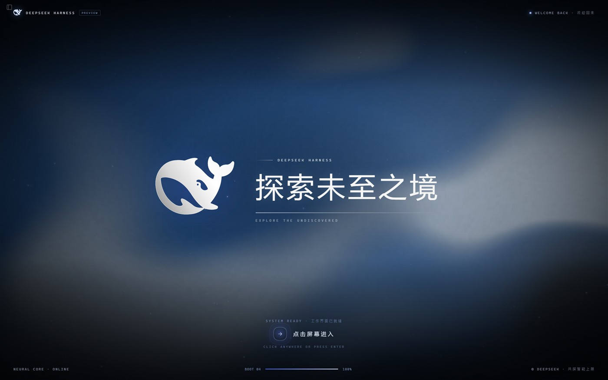
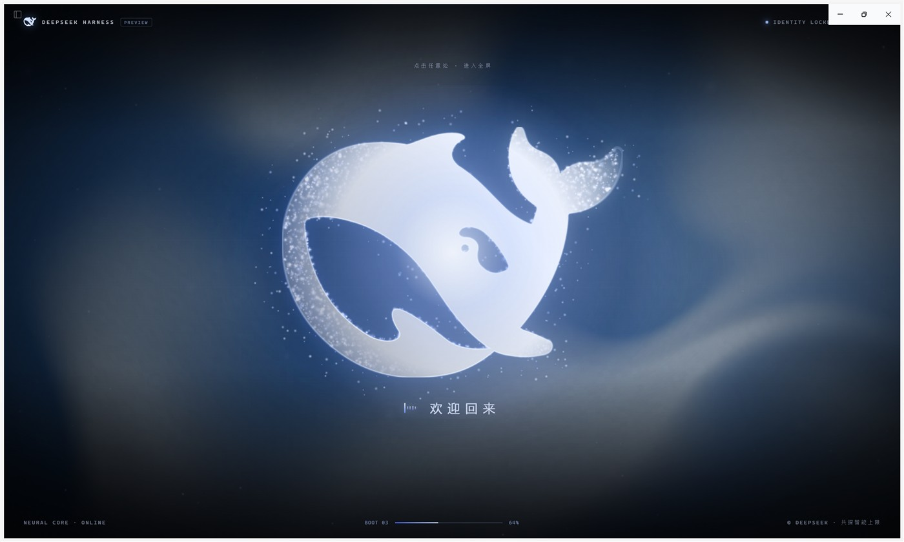

# DSH Boot Animation

An unofficial fullscreen boot animation plugin for **DeepSeek Harness**: particles converge into the DeepSeek whale, a synthetic female voice says "欢迎回来" (Welcome back), the mark turns monochrome, then the tagline "探索未至之境" appears with a left-to-right glow. Click anywhere to enter the workspace.

> Unofficial fan project, not affiliated with DeepSeek. The DeepSeek whale mark and name are trademarks of DeepSeek; see [NOTICE.md](NOTICE.md).

Monochrome spreading from an interior point:

## Features

- Fullscreen via the Fullscreen API, with the Harness shell menu hidden; a small hint lets you retry fullscreen with a click if auto-fullscreen is blocked.
- WebGL2 fluid background inspired by the DeepSeek Harness marketing page.
- Thousands of particles sampled from the official whale SVG, with depth-based size/brightness, bright cores, star glints, floating dust, energy filaments and glowing nodes, plus a solidification burst.
- Two Chinese voice lines with a separate machine layer (ring modulation, short comb and slight bit reduction) for a mechanical timbre without losing intelligibility, plus short UI sound effects.
- After solidification the whale and title become monochrome while the background keeps its color; the whale's color spreads outward from one interior point, with no ring or box frame.
- Characters appear slowly, each with a white glow and a left-to-right light sweep; the glow ends when the text is complete.
- After the text completes, hovering the whale or title opens a compact 160 px 2× circular magnifier around the cursor.
- Click anywhere or press Enter to leave the animation and enter the Harness workspace.

See `README.md` (Chinese) for installation and build instructions. The short version:

1. Clone the repository.
2. Install the `plugin/` directory through Harness's local plugin installation, or add it to your profile's `package.json` as a `link:` dependency plus a bundle entry (see Chinese README).
3. Reload the Harness window.

Build after edits: `node build-client.mjs`. Voice regeneration requires Python with `edge-tts`, `soundfile`, `scipy`, `numpy`; commands are in the Chinese README.

## License

Code is [MIT licensed](LICENSE). Third-party assets (DeepSeek whale mark, DeepSeek name, the site-inspired shader, Edge TTS generated audio) are not covered by MIT; see [NOTICE.md](NOTICE.md).
