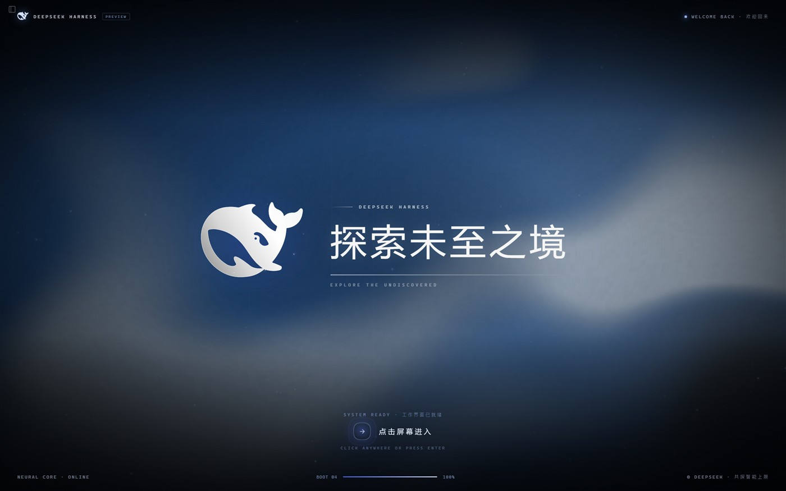
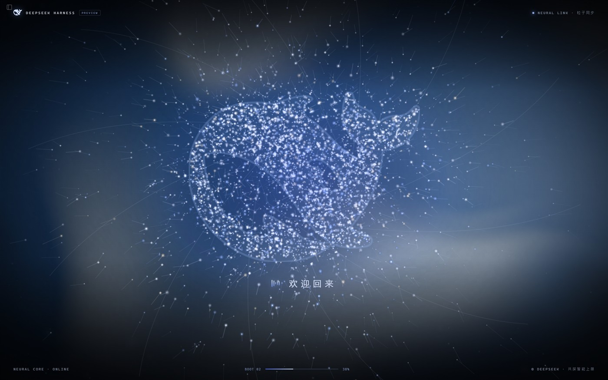
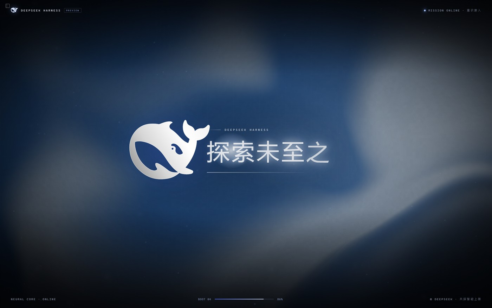
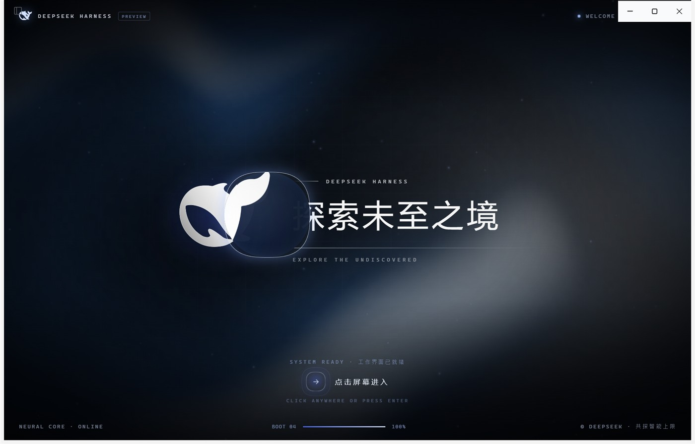

# DSH Boot Animation

一个非官方的 **DeepSeek Harness 全屏开机动画**插件。粒子汇聚成鲸鱼、机械女声欢迎回来、实体化后转为黑白，随后进入「探索未至之境」，点击进入工作界面。

> 非官方实验性插件，与 DeepSeek 官方无关。鲸鱼标识、DeepSeek 名称及相关素材的权利归 DeepSeek 所有，详见 [NOTICE.md](NOTICE.md)。



## 效果

- **全屏开场**：自动请求系统全屏，并隐藏 Harness 自带的标题栏菜单；失败时顶部提示「点击任意处 · 进入全屏」。
- **深色流体背景**：参考 [deepseek.com/harness](https://www.deepseek.com/harness/) 的深蓝流体/暖光/网格氛围，WebGL2 实时渲染。
- **粒子鲸鱼**：数千颗粒子沿弧线汇聚，形成 DeepSeek 鲸鱼标识；按景深区分大小与亮度，叠加亮核、星芒、光尘、能量丝线和发光节点，实体化时带粒子爆发。
- **机械女声**：中文神经女声叠加独立的机械层（环形调制、短梳状滤波与轻微降位），保持咬字清晰的同时增加机械质感，说出「欢迎回来」和「探索未至之境」，并配有通讯提示音和实体化/文字出现音效。
- **黑白实体化**：鲸鱼和标题在实体化后转为黑白/银灰，背景保留蓝色氛围；过渡过程不使用圆环或方框，直接由粒子与光晕过渡到实体标识。
- **逐字发光**：标题逐字慢速出现，每个字带白色光晕，并有一条从左向右扫过的光带；全部出现后光效结束。
- **悬停放大镜**：文字完全出现后，鼠标移到鲸鱼或标题上，会出现 160px 圆形放大镜（2 倍），圆形区域内为放大内容，移出后消失。
- **点击进入**：点击任意处或按 Enter，淡出动画并进入 Harness 工作界面。

粒子汇聚中：



逐字发光：



悬停放大镜：



## 安装

环境要求：DeepSeek Harness Desktop（Windows 上测试，版本 `0.2.1-rc.5`）。

1. 克隆本仓库：

   ```bash
   git clone https://github.com/gaojiahao419/dsh-boot-animation.git
   ```

2. 安装 `plugin/` 目录。推荐使用 Harness 的插件管理功能从本地目录安装；如果当前版本不支持目录安装，可手动把插件加入 profile：

   编辑 `%USERPROFILE%\.dsh\profiles\<profile>\package.json`，加入依赖与 bundle：

   ```json
   {
     "dependencies": {
       "@local/dsh-boot-animation": "link:D:/path/to/dsh-boot-animation/plugin"
     },
     "dsh": {
       "profile": {
         "bundles": [
           "...",
           "@local/dsh-boot-animation"
         ]
       }
     }
   }
   ```

   然后在 profile 目录执行 `pnpm install`，重启 Harness。

3. 页面每次加载时动画会自动播放；播放结束后点击进入，或按 Enter。

> 动画是页面加载时触发，不是系统级登录动画。关闭并重新打开 Harness 窗口即可再次观看。

## 构建

`plugin/client.js` 是已构建好的客户端产物，直接安装即可，无需构建。要修改代码后重新构建：

```bash
node build-client.mjs
```

构建会读取：

- `src/boot.template.js`：动画、样式与组件源码（占位符由构建脚本替换）
- `research/whale.svg`：DeepSeek 鲸鱼矢量路径
- `assets/welcome-bot.wav`、`assets/tagline-bot.wav`：处理后的女声
- `assets/sfx-*.wav`：提示音与转场音效

### 重新生成语音（可选）

需要 Python 3.10+ 与 `edge-tts`、`soundfile`、`scipy`、`numpy`：

```bash
python -m edge_tts --voice zh-CN-XiaoxiaoNeural --rate=-10% --pitch=-6Hz --volume=+15% --text "欢迎回来。" --write-media assets/welcome-edge.mp3
python -m edge_tts --voice zh-CN-XiaoxiaoNeural --rate=-26% --pitch=-6Hz --volume=+15% --text "探索未至之境。" --write-media assets/tagline-edge.mp3
python tools/prepare-edge-voice.py
node tools/process-voice.mjs
python tools/make-sfx.py
node build-client.mjs
```

## 目录结构

```text
plugin/              Harness 插件包（可安装目录）
  client.js          Web UI 客户端产物
  index.js           Host 半（空实现，仅用于加载 bundle）
src/boot.template.js 动画源码模板
build-client.mjs     构建脚本：内联鲸鱼路径/音频，生成 client.js
assets/              女声、音效与中间音频文件
research/whale.svg   官方鲸鱼矢量路径
tools/               语音准备/处理与音效生成脚本
docs/                README 截图
```

## 技术要点

- 通过 Harness Client Slot `shell.overlay` 注册一个全屏浮层，避免修改应用布局。
- 粒子在离屏 Canvas 上从 SVG 路径采样轮廓与填充点，逐帧动画汇聚。
- 背景为 WebGL2 片元着色器（流体噪声、暖光、颗粒、暗角），按 30fps 渲染以给文字动画留出 GPU。
- 语音为 HTMLAudioElement 播放，`speechSynthesis` 作为兜底，避免 WebAudio 图在某些环境下无声。
- 全屏使用 `requestFullscreen()`，并隐藏 HTML 菜单；若被浏览器拒绝，退化为最大化窗口并提示点击补全屏。

## 已知限制

- 主要在 Windows Electron 桌面版验证；Web 版的全屏与窗口壳可能不同。
- 自动全屏依赖浏览器/Electron 的授权；被拒绝时需要点击一次提示。
- 页面处于最小化或后台时，浏览器会节流定时器，动画节奏可能落后；观看时请保持窗口在前台。
- 音频使用 Edge TTS 生成，商用前请替换为你有权使用的配音。

## License

代码采用 [MIT License](LICENSE)。仓库中涉及的第三方素材（DeepSeek 鲸鱼标识、DeepSeek 名称、基于官网背景的着色器、Edge TTS 生成的音频等）不属于 MIT 授权范围，权利归各自所有者，使用前请阅读 [NOTICE.md](NOTICE.md)。
